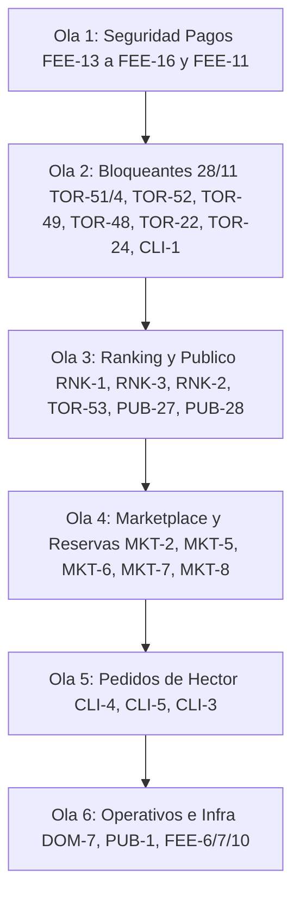

# Plan de Correccion y Validacion - Re-test 24/11 Padel Nexus

Copia de trabajo en repo (origen: plan Cursor `plan_re-test_24-11_padel_nexus_35a4afdf`).  
Seguimiento diario: [qa-re-test-24-11-progreso.md](./qa-re-test-24-11-progreso.md).

## Metodologia de Ejecucion (Uno por Uno + Tests)

- Cada item se implementa en orden **Database-First -> Backend -> Frontend** cuando aplique.
- Cada item incorpora o actualiza tests unitarios/integracion en `apps/api/test/` y/o `apps/web/test/` antes de pasar al siguiente.
- Validacion por item: `pnpm --filter api test`, tests de `apps/web/test/`, `pnpm --filter api build`, `pnpm --filter web lint` y `pnpm --filter web build` al cerrar cada bloque.
- Cero HTTP directo en UI (todo via `apps/web/utils/services/`), cero `alert`/`confirm`/`prompt`, cero `any`.

## Ola 3 - Ranking y Sitio Publico (RNK / TOR-53 / PUB) — SIGUIENTE

- **13. RNK-1** — `GET /rankings/mis-contextos`, FK historial_ranking, aterrizaje torneo reciente.
- **14. RNK-3** — Filtro Damas / Caballeros en `/ranking`.
- **15. RNK-2 y TOR-53** — Pestanas Club | Provincial | Nacional; puntos de torneos Local en Provincial + Club.
- **16. PUB-27** — Puesto unificado panel jugador vs `/ranking`.
- **17. PUB-28** — Excluir datos QA en rankings; limpieza Supabase con confirmacion.

Detalle completo de archivos y criterios de aceptacion: ver secciones 13-17 del plan maestro en Cursor o el export L1-L184.

## Referencia Olas 1-2 y 4-6

Las olas 1 (FEE), 2 (TOR/CLI-1 bloqueantes 28/11), 4 (MKT), 5 (CLI Hector) y 6 (DOM/FEE/PUB) conservan el mismo alcance del plan original; el progreso de implementacion se anota en `qa-re-test-24-11-progreso.md`.