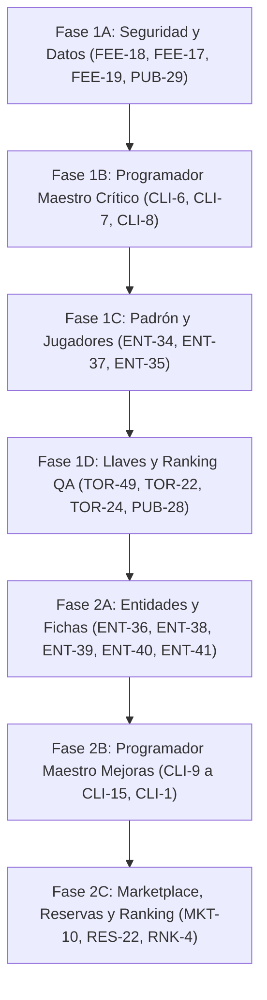

# Plan de correcciones — Re-test 25/11 Padel Nexus

Origen: PDF Re-test 25/11 (Dylan).  
Seguimiento: [qa-re-test-25-11-progreso.md](./qa-re-test-25-11-progreso.md).

## Progreso resumido (26/11/2026)

| Fase | Bloque | Estado |
|------|--------|--------|
| 1 | 1A Seguridad (FEE-17/18/19, PUB-29) | Completado |
| 1 | 1B Programador crítico (CLI-6/7/8) | Completado |
| 1 | 1C Padrón/jugadores (ENT-34/37/35) | Completado |
| 1 | 1D Llaves + ranking QA (TOR-49/22/24, PUB-28) | Completado en código |
| 2 | 2A Entidades/fichas (ENT-38/39/40/41) | Completado; **ENT-36 pendiente** |
| 2 | 2B Programador mejoras (CLI-9 … CLI-15, CLI-1) | **Siguiente: CLI-12 / CLI-13** |
| 2 | 2C MKT-10, RES-22, RNK-4 | Pendiente |

Commits recientes del bloque 1D y 2A: `323df9e`, `5401c53`, `219266f`, `8a8d35e`, `c5b70e6`.

## Metodología de ejecución (ítem por ítem)

Cada ítem en orden **Base de datos -> Backend -> Frontend -> Tests y validación**:

- Revisar alcance de permisos/RLS antes de codificar.
- Cambio mínimo tipado: sin `any`, sin HTTP en UI, sin `alert`/`confirm`/`prompt`, sin emojis.
- Tests en `apps/api/test/` y `apps/web/test/` cuando aplique (caso feliz + no autorizado + borde).
- Validar tests y build del slice tocado antes del siguiente ítem.

---

## Fase 1 — Prioridad antes del 28/11

### Bloque 1A: Seguridad y datos personales — HECHO

1. **FEE-18** — Autorización `DELETE /inscripciones/:id`.
2. **FEE-17** — Autorización `PATCH /inscripciones/:id/pago`.
3. **FEE-19** — `POST /inscripciones`: jugador 1 solo desde sesión.
4. **PUB-29** — Sin PII en API pública de ranking.

### Bloque 1B: Programador maestro crítico — HECHO

5. **CLI-6** — Sin partidos simultáneos del mismo jugador en el evento.
6. **CLI-7** — Drop protegido en celda de otra categoría.
7. **CLI-8** — Generar cuadros y publicar respetando ocupación del evento.

### Bloque 1C: Padrón FAP y jugadores — HECHO

8. **ENT-34** — Rendimiento `GET /licencias` (índices + RPC resumen).
9. **ENT-37** — Búsqueda AND por tokens en jugadores.
10. **ENT-35** — Activación padrón FAP sin contacto (staff + autoservicio OTP).

### Bloque 1D: Llaves y ranking QA — HECHO (código)

11. **TOR-49** — Reducir falso aviso «Revisar horarios publicados».
12. **TOR-22** — Alta pareja en pase directo / UI sin acción inválida.
13. **TOR-24** — Recalcular cupos de llave al mover zonas (+ no tocar hojas finalizadas).
14. **PUB-28** — Exclusión QA en ranking y puntos; **limpieza DB pendiente OK Héctor**.

Detalle de archivos y tests: ver commits en [qa-re-test-25-11-progreso.md](./qa-re-test-25-11-progreso.md).

---

## Fase 2 — Prioridad media y baja (post 28/11)

### Bloque 2A: Entidades y fichas

15. **ENT-38** — Alcance `PATCH ficha-provisoria` por jurisdicción. **HECHO**
16. **ENT-39** — Propagar nombre a inscripciones (torneos no finalizados). **HECHO**
17. **ENT-36** — Baja clubes: historial sin licencia auto sin pagos + aviso canchas. **PENDIENTE**
18. **ENT-40** — Baja asociaciones/federaciones (historial, 404, UI). **HECHO**
19. **ENT-41** — Corrección DNI superadmin + historial visible. **HECHO**

### Bloque 2B: Programador maestro (mejoras)

20. **CLI-9** — Compartir sedes/canchas del evento entre categorías. **HECHO**
21. **CLI-10** — Descanso entre categorías con «Por definir». **HECHO**
22. **CLI-11** — Reparto equilibrado y orden de prioridad persistente. **HECHO**
23. **CLI-12 / CLI-13** — Capacidad evento, nombre, celdas atenuadas, filtro sede. **SIGUIENTE**
24. **CLI-14 / CLI-15** — Evento agrupado en listados; replicar por pares nivel+rama.
25. **CLI-1** — Planilla: provincia en celda, Centenario, nº de fila en avisos.

### Bloque 2C: Marketplace, reservas y ranking club

26. **MKT-10** — Estado claro tienda suspendida en panel club.
27. **RES-22** — Pago en el club sin marcar completado ni monto del cliente.
28. **RNK-4** — Ranking público: clubes activos, sin preselección anónima.

---

## Ítems operativos / fuera de código

- **DOM-7**: Vercel DNS `padelnexus.com.ar`.
- **MKT-8 / MKT-9**: Activación de tiendas al lanzamiento.
- **Verificación posterior al 28/11**: `PUB-1`, `PUB-27`, `RNK-1`, `RNK-2`, `FEE-6/7/10/11`.